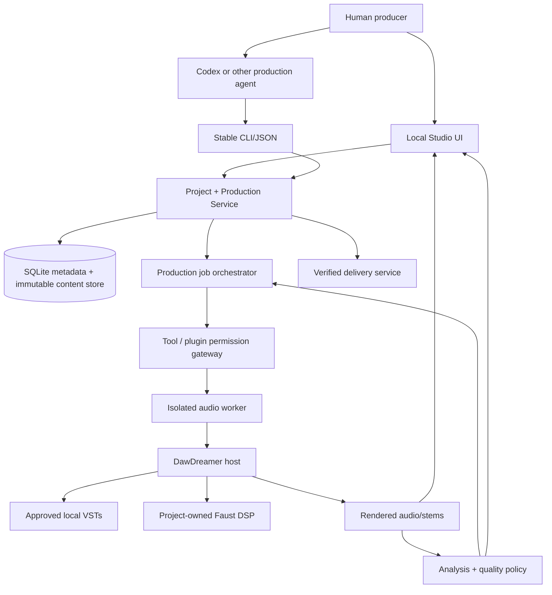

# ADAW — System Architecture v0.4

**Status:** Greenfield proposed design; DawDreamer integration subject to G0 proof  
**Audience:** Codex architect, implementation agent, independent verifier  
**See also:** [Engine/VST contract](03-DAWDREAMER-VST-FAUST.md), [Revision contract](04-PROJECT-AND-REVISION-CONTRACT.md), [CLI](06-AGENT-INTERFACE.md)

## 1. Architectural thesis

ADAW should own the **meaning** of a musical project and the **evidence** for a finished export. DawDreamer should execute compatible **audio graphs**. Codex should operate ADAW through a durable **agent interface**. The human owns artistic approval. No renderer, plug-in, UI view, Python script or agent run may become a second canonical source of truth.

**Do not recreate v0.3's independent full audio engine.** Build small reference processors only for numeric test fixtures and recovery/fallback. Use DawDreamer as the principal offline backend once G0 proves its requested behavior on the Windows target. Maintain a narrow adapter contract rather than speculative multi-backend architecture work.

### Logical diagram

The graph is **conceptual**: this document does not mandate one process per box. It does mandate separate authority boundaries for persistent project mutations, untrusted plugin/code execution, and quality evaluation.

## 2. Components, ownership and prohibited shortcuts

| Subsystem | Owns | Must not do |
|---|---|---|
| Project service | Validation, atomic commits, head, revisions, asset staging, conflicts, backups | Run arbitrary VST/agent-authored code in-process |
| Canonical store | Structured source, manifests, hashes, plugin references, immutable source/modules/assets | Treat render cache/pickle as master document |
| Plugin registry | Explicit installed plugin selection, scan/evidence, stable reference, parameter catalog, approvals | Trust every downloaded binary or assume all parameters documented |
| Render graph compiler | Translate canonical source into DawDreamer processors + routing, schedule events, parameter automation | Write project head or silently substitute missing plugin |
| DawDreamer worker | Native plugin/Faust construction, audio graph execution, WAV/stems and diagnostics | Call privileged project service DB directly |
| Production orchestration | Bounded plan/execution/refinement, user constraints, job status and trace | Independently approve subjective artistic goals |
| Quality subsystem | Objective meters, contextual diagnostics, profile checks, evidence invalidation | Claim to hear music solely through waveforms/metrics |
| Preview/Studio UI | Playback, source inspector, mixer/editor, revision/diff, visible approval | Own separate copies of persistent musical parameters |
| CLI/API | Typed commands, machine-readable results, idempotency, session policy | Bypass service validation; write SQLite directly |
| Export service | Actual file validation, profile-specific metadata, source/export hashes, archive | Treat an unvalidated cache file as owner-approved master |

## 3. Proposed technology stack

**Target:** Windows 11 x64 local development and use. Use native Windows Python for VST installation compatibility (WSL is not the authoritative VST runtime). **Python 3.12 x64** is the proposed G0 baseline; validate wheels on target before locking. For DawDreamer baseline, pin `0.9.0` and record wheel SHA/version; investigate newer compatible versions only by explicit ADR. Current official repo states Python 3.11–3.14 Windows x64 wheels. Use NumPy/SciPy or another test-backed reader/writer/analyzer toolchain; select a verified BS.1770 meter implementation.

**Service:** Python for fast integration with DawDreamer and analysis; minimal HTTP framework chosen and pinned at G0/G1. **Metadata:** SQLite with SQL transactions and migration path; canonical JSON serialized deterministically, content addressable source/modules/assets on disk. **UI:** TypeScript/React suggested from v0.3, introduced when CLI production loop works. Prefer a small web client; no forced VICT/TORI dependency. **CLI:** Python or small cross-platform wrapper; same service semantics. **Distribution:** local home tool; no distributed commercial installer in G0/G1.

Do not treat these choices as owner-approved forever; new dependencies require tests, rationale and lockfile.

## 4. Processes and privileged execution

### 4.1 Process A — project and API service

- Persists only validated, staged, atomic commits.
- Runs on localhost with session token, CORS/origin checks and explicit mutation authorization.
- Has permission to modify canonical project folders, not arbitrary machine paths without a user-selected import/export grant.
- Does not import untrusted DSP, load VST binaries, or deserialize untrusted pickle.

### 4.2 Process B — audio worker(s)

- Starts with immutable manifest + content-addressed asset snapshot + explicit allowed local plugin registry references.
- Constructs DawDreamer graph and executes one job with time/cpu/memory limits as practical on Windows.
- Writes to a staging area; sends manifest of results and process diagnostics to service; service validates hash/format and atomically publishes artifacts.
- A plugin process crash must not terminate the service or destroy last accepted audio.
- Sandboxing is a **separate verification task**. A Windows subprocess alone is not a hardened sandbox. If enforceable restrictions are absent, restrict third-party code/VST loading to an owner-approved trusted local allowlist and explicitly report residual host risk.
- Never execute arbitrary shell commands embedded inside musical source modules; Faust source is a constrained DSP language, but generated programs/tools still require authorization.

### 4.3 Process C — analysis/evaluation (may be separate worker)

- Measures completed **actual audio**, separately from rendering.
- Applies a versioned profile and returns `pass/fail/warn/unknown/not_applicable` with evidence.
- Diagnoses, but does not silently commit a 'best' mix or assert artistic approval.

## 5. Canonical processing topology

Source `project revision` → validate → compile typed performance/events + audio assets → resolve installed plugin + state + Faust code → topological audio graph → DawDreamer render → normalized float audio/stems → output conversion/dither as defined → byte-level verification → profile QA → review.

**Initial graph** supports: instrument/source track → track inserts → track gain/pan → optional group buses → ordered master processors → PCM output. Optional parallel tracks. All buses are acyclic and each audible track reaches a master. Channel counts must be validated at compile; no channel truncation without explicit channel mapper. Gain/pan law, clip boundaries, non-linear processing, effect tails, processor latency and export alignment must be defined/tested rather than guessed.

**Sidechain:** A plugin may declare main and sidechain buses; ability to connect them in DawDreamer/that VST is explicitly compatibility tested. Unsupported sidechains produce a capability error or alternative staged implementation; do not silently treat ordinary audio input as an active sidechain. See [03](03-DAWDREAMER-VST-FAUST.md).

## 6. Timeline and signal fidelity

- Suggested initial timebase **960 PPQ**; fixed BPM and 4/4 during early fixtures. This is a deliberate initial scope—not a universal musical restriction.
- Stable event IDs. Half-open tick ranges and explicit project end and export tail.
- All timing moves through a tested tick→sample conversion from one tempo origin; time-based VST MIDI and PPQ automation reconciled to the same timeline. Avoid drift across song sections.
- Define automation mode, point IDs, interpolation and before/after-coverage behavior in canonical project. Generate DawDreamer automation arrays only at render time; test step granularity vs block size.
- DSP state/tails: render full context or documented preroll; preview slicing must match full-song output at a chosen region where comparison is promised. Stateful VSTs may not guarantee sample-identical slices.
- 48 kHz stereo 24-bit WAV is **proposed generic delivery example**, not a universal release specification. Internal float rendering and output conversion rules must be explicit.

## 7. Job model and candidate lifecycle

All long-running work is a job with durable ID, immutable input hash, timestamps, worker/env identity, state, cancel/retry policy, logs and output hash(s).

`queued → validating → preparing_graph → rendering → analyzing → candidate_ready → awaiting_review → accepted/rejected` with terminal branches `failed`, `cancelled`, `blocked` and corresponding structured diagnostics.

**Internal iterations:** A production request may run multiple candidate sub-jobs within a user-specified cap. Each candidate gets independent audio, source/hash, quality evidence and comparison record. No iteration can silently promote a master or overwrite approved revision. A render job may reuse cache only if all meaningful inputs are pinned; plugin non-determinism can reduce cache trust grade.

## 8. Reproducibility levels

- **Level D1 – deterministic:** Same same-platform binary/versions/settings/assets/seed produces matching PCM under documented conditions; tested.
- **Level D2 – asset-reproducible:** A frozen/referenced audio result can be remixed deterministically, but recreating upstream generator output is not guaranteed.
- **Level D3 – environment-dependent:** A VST, license, plugin state, OS/host build or nondeterministic algorithm prevents known exact replay; record requirements and preserve frozen render for audition if license allows.

Declare observed grade per project/rendition. Do not claim DawDreamer guarantees sample identity across all plugins: different plugins are different native programs.

## 9. Fault tolerance and storage

- SQLite transaction with immutable history and command-id idempotency; atomic filesystem replacement for artifact publication.
- Hash all referenced assets, modules, plugin-state blobs, exports and profile definitions.
- During a crash, reconcile `running` jobs to `interrupted` or resume only where safe; do not reapply non-idempotent external actions.
- Back up database before schema migration. Portable project import validates hashes and reports missing dependencies. No absolute VST path as the sole portable identity.
- Version the graph compiler and effective render options. Use schema migrations; never silently rewrite prior source meaning.

## 10. Explicit implementation decisions deferred to G0

1. Audio adapter exact method signatures and multichannel/sidechain capabilities.
2. Native worker process startup, plugin scanner isolation, and log capture on Windows.
3. Verified sample-rate/block-size/automation behavior, latency and tail handling.
4. Tested sample-peak/BS.1770 meter library with calibrations.
5. Plugin snapshot restore strategy and stable parameter mapping.
6. Details of trusted local-user execution boundary and practical filesystem restrictions.
7. Measured 8-bar and 60–90-second render budgets on target hardware.

After G0, record an ADR reflecting actual evidence. Do not invent capabilities simply because the upstream README lists a broad feature category.
